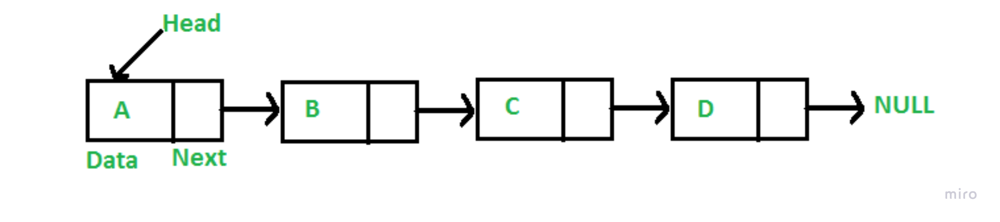
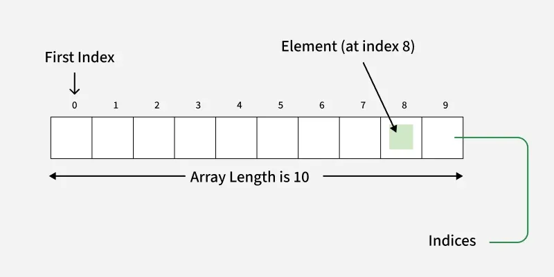

# Simple truths

* indexed
* can't be resized easily
* same type of elements
* stored as cont. block
* not mutable
* read > write
* fixed amount of elemenets
* Random accesss

# Big O

| operation | cost |
| ----------| -----|
| read | O(n) |
| write | O(1) |
| remove | O(1) |

Space is O(n) to declare array.
No space is needed for search or access.

# Declare array in Python

import array

arr = array.array("i", [1, 2, 3, 4])  # i stands for integer

# Images

