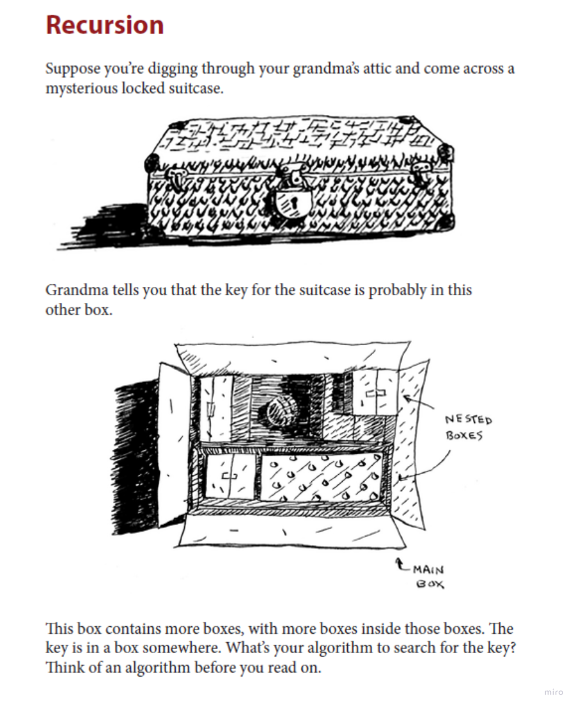

# Simple truths about Recursion

* Making a function call itself.
* Uses the stack to save the values of each call for a return.
* Has a base case and a recursive case.
* When you call a function from another function, the calling function is paused in a partially completed state.
* All the values of the variables for that function are still stored in memory.

# Big O

Runtime is usually O(n) as you go as deep as you need.

Space is O(n) for the stack.