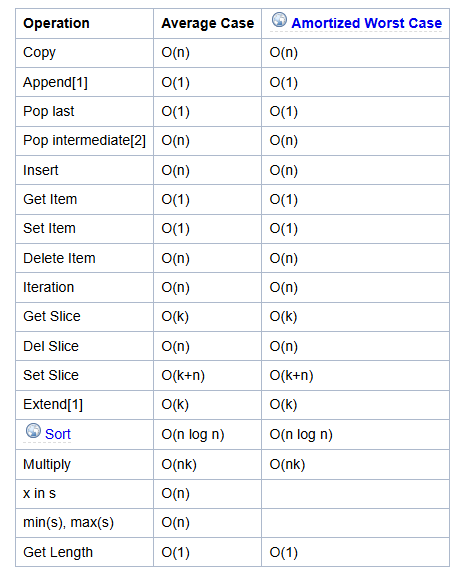

# 1. Whetting Your Appetite

- Python is simple to use, but it is a real programming language, offering much more structure and support for large programs than shell scripts or batch files can offer. On the other hand, Python also offers much more error checking than C, and, being a very-high-level language, it has high-level data types built in, such as flexible arrays and dictionaries. 

- Because of its more general data types Python is applicable to a much larger problem domain than Awk or even Perl, yet many things are at least as easy in Python as in those languages.

- Python allows you to split your program into modules that can be reused in other Python programs.


**Python enables programs to be written compactly and readably. Programs written in Python are typically much shorter than equivalent C, C++, or Java programs, for several reasons:**

- the high-level data types allow you to express complex operations in a single statement;

- statement grouping is done by indentation instead of beginning and ending brackets;

- no variable or argument declarations are necessary.


Python is extensible: if you know how to program in C it is easy to add a new built-in function or module to the interpreter

**- By the way, the language is named after the BBC show “Monty Python’s Flying Circus” and has nothing to do with reptiles.**

# 2. Using the Python Interpreter

**The Python interpreter is usually installed as /usr/local/bin/python3.13 on those machines where it is available; putting /usr/local/bin in your Unix shell’s search path makes it possible to start it by typing the command:**

    python3.13


Typing an end-of-file character (Control-D on Unix, Control-Z on Windows) at the primary prompt causes the interpreter to exit with a zero exit status. 

The interpreter operates somewhat like the Unix shell: when called with standard input connected to a tty device, it reads and executes commands interactively; when called with a file name argument or with a file as standard input, it reads and executes a script from that file.

A second way of starting the interpreter is 

    python -c command [arg] ..., 


which executes the statement(s) in command, analogous to the shell’s -c option.

# 2.2.1. Source Code Encoding

By default, Python source files are treated as encoded in UTF-8.

3.1. Using Python as a Calculator

Start the interpreter by:

    python3

Operations:
- ** calculate powers
- / + - arithmetic operators
- =

# 3.1.2. Text

    'spam eggs'  # single quotes
    "Paris rabbit got your back :)! Yay!"  # double quotes
    '1975'  # digits and numerals enclosed in quotes are also strings


* To quote a quote, we need to “escape” it, by preceding it with ```\. ```

    'doesn\'t'  # use \' to escape the single quote...

    "doesn't"

    "doesn't"  # ...or use double quotes instead

* If you don’t want characters prefaced by \ to be interpreted as special characters, you can use raw strings by adding an r before the first quote:

    ```python
    print('C:\some\name') 
    ```

* String literals can span multiple lines.

```python
print("""\
Usage: thingy [OPTIONS]
     -h                        Display this usage message
     -H hostname               Hostname to connect to
""")
```

# Indexing text

str class

**Strings are immutable**

```python
word = 'python'

word[0]
word[5]
word[-1] # reverse, last character
word[0:2] #slicing
len(word)
```

# 3.1.3. Lists

**lists are mutable**


Python knows a number of compound data types, used to group together other values. 

* The most versatile is the list, which can be written as a list of comma-separated values (items) between square brackets. 

```python
squares = [1, 4, 9, 16, 25]
squares
```
* Lists might contain items of different types, but usually the items all have the same type.

* Like strings **(and all other built-in sequence types)**, lists can be indexed and sliced:

```python
squares[0]  # indexing returns the item

squares[-1]

squares[-3:]  # slicing returns a new list
```

* squares + [36, 49, 64, 81, 100]
[1, 4, 9, 16, 25, 36, 49, 64, 81, 100]


## Methods

* append

```python
myList.append()
```

* shallow/deep copying:

    All slice operations return a new list containing the requested elements. 

    ```python
    correct_rgba = rgba[:]
    ```

* Assignment to slices

    ```python
    letters[2:5] = ['C', 'D', 'E']
    ```

* Getting len

    ```python
    letters = ['a', 'b', 'c', 'd']
    len(letters)
    ```
* Nesting lists

    ```python
    a = ['a', 'b', 'c']
    n = [1, 2, 3]
    x = [a, n]
    x
    ```

# 4. More Control Flow Tools

## if Statements

```python
x = int(input("Please enter an integer: "))
Please enter an integer: 42
if x < 0:
    x = 0
    print('Negative changed to zero')
elif x == 0:
    print('Zero')
else:
    print("YES")
```

## 4.2 for statements

* The for statement in Python differs a bit from what you may be used to in C or Pascal. 

* Rather than always iterating over an arithmetic progression of numbers (like in Pascal), or giving the user the ability to define both the iteration step and halting condition (as C), Python’s for statement iterates over the items of any sequence (a list or a string), in the order that they appear in the sequence.

    ```python
    words = ['cat', 'window', 'defenestrate']
    for w in words:
        print(w, len(w))
    ```

## 4.3 range function

If you do need to iterate over a sequence of numbers, 
the built-in function range() comes in handy. 

It generates arithmetic progressions:

```python
for i in range(5):
    print(i)
```

The given end point is never part of the generated sequence; range(10) generates 10 values, 
the legal indices for items of a sequence of length 10.

Combine range and len

```python
a = ['Mary', 'had', 'a', 'little', 'lamb']
for i in range(len(a)):
    print(i, a[i])
```

* What happens if you write ```range(10)```?

In many ways the object returned by range() behaves as if it is a list, but in fact it isn’t. 

It is an object which returns the successive items of the desired sequence when you iterate over it, but it doesn’t really make the list, thus saving space.

**We say such an object is iterable, that is, suitable as a target for functions and constructs that expect something from which they can obtain successive items until the supply is exhausted**

## 4.4 break and continue

```python
for n in range(2, 10):
    for x in range(2, n):
        if n % x == 0:
            print(f"{n} equals {x} * {n//x}")
            break
```

## 4.5 else clauses on LOOPS

* In a for or while loop the break statement may be paired with an else clause. 
* If the loop finishes without executing the break, the else clause executes.

```python
for n in range(2, 10):
    for x in range(2, n):
        if n % x == 0:
            print(n, 'equals', x, '*', n//x)
            break
    else:
        # loop fell through without finding a factor
        print(n, 'is a prime number')
```

## 4.6 pass Statements

* The pass statement does nothing. It can be used when a statement is required syntactically 
but the program requires no action. For example:

```python
class MyEmptyClass:
    pass
```

## 4.7 match statement

* A match statement takes an expression and compares its value to 
successive patterns given as one or more case blocks. 

```python
def http_error(status):
    match status:
        case 400:
            return "Bad request"
        case 404:
            return "Not found"
        case 418:
            return "I'm a teapot"
        case _:
            return "Something's wrong with the internet"
```

Combining

```python
case 401 | 403 | 404:
    return "Not allowed"
```

## 4.8 Define functions

We can create a function that writes the Fibonacci series to an arbitrary boundary:

```python
def fib(n):    # write Fibonacci series less than n
    """Print a Fibonacci series less than n."""
    a, b = 0, 1
    while a < n:
        print(a, end=' ')
        a, b = b, a+b
    print()
```

* The keyword def introduces a function definition.
* It must be followed by the function name and the parenthesized list of formal parameters
* The first statement of the function body can optionally be a string literal; this string literal is the **function’s documentation string**, or **docstring**.
* The execution of a function introduces a new symbol table used for the local variables of the function.

## How does the lookup work of variables?

1.  variable references first look in the local symbol table
2.  then in the local symbol tables of enclosing functions
3.  then in the global symbol table
4.  finally in the table of built-in names.

## Passing values

**Call by value**
The actual parameters (arguments) to a function call are introduced in the local symbol table of the called function when it is called; thus, arguments are passed using **call by value**.

**When a function calls another function, or calls itself recursively, a new local symbol table is created for that call.**

A function definition associates the function name with the function object in the current symbol table. The interpreter recognizes the object pointed to by that name as a user-defined function. Other names can also point to that same function object and can also be used to access the function:

```python
fib
<function fib at 10042ed0>
f = fib
f(100)
```

## Default values

```python
def ask_ok(prompt, retries=4, reminder='Please try again!'):
```

**Important warning: The default value is evaluated only once, if you are assigning a value that is nota constant, but another variable**

## Keyword arguments

* Functions can also be called using keyword arguments of the form kwarg=value. For instance, the following function:

```python
def parrot(voltage, state='a stiff', action='voom', type='Norwegian Blue'):
```
## Arbitrary arguments list

Finally, the least frequently used option is to specify that a function can be called with an arbitrary number of arguments.

```python
def write_multiple_items(file, separator, *args):
```

##  Unpacking Argument Lists

```python
def parrot(voltage, state='a stiff', action='voom'):
    print("-- This parrot wouldn't", action, end=' ')
    print("if you put", voltage, "volts through it.", end=' ')
    print("E's", state, "!")

d = {"voltage": "four million", "state": "bleedin' demised", "action": "VOOM"}
parrot(**d)
```

## Lambda expressions

```python
def make_incrementor(n):
    return lambda x: x + n

f = make_incrementor(42)
```

## Docstrgins

```python
def my_function():
    """Do nothing, but document it.

    No, really, it doesn't do anything.
    """
    pass
```

# 5. Data structures

All data structures that I know:
- list
- array
- queue
- stack
- hashtable (dict)
- tree
- graph
- primitive variables
- tuple
- set
- heap
- trie


## 5.1 List functions

* list.append(x)
* list.extend(x)

    Append all items from an iterable object (collection, sequence)

* list.insert(i)
* list.remove()
* list.pop([i])
* list.clear()
* list.index(x[, start[, end]])
    
    Return zero-based index in the list of the first item whose value is equal to x.

* list.count(x)

    Return the number of times x appears in the list.

* list.sort(*, key=None, reverse=False)

    Sort the items of the list in place
    If text, sorts by Unicode code points (i.e., the ASCII or Unicode values of the characters).
    **does it in-place.**

    **alternative: sorted()**

* list.reverse()

    Reverse the elements of the list in place.

    Also exists a return value option: ```reversed()```

* list.copy()

    Return a shallow copy of the list. Similar to ```a[:]```



## 5.11 Using Lists as Stacks

The lsit methods make it very easy to use a list as a stack, where the last element added is the first element retrieved (LIFO), last in, first out.

Use these functions make list act as an stack:
- list.append()
- list.pop()

```python
stack = [3, 4, 5]
stack.append(6)
stack.append(7)
stack
[3, 4, 5, 6, 7]
stack.pop()
7
```

## 5.1.2 Using Lists as Queues

You can also use lists as queues as well, following the FIFO (first in, first out) principle.
Lists are not efficient for this purpose.

* We are using deque from the collections.

```python
from collections import deque
queue = deque(["Eric", "John", "Gintas"])
queue.append("Tom")
queue.append("Graham")
queue.popleft()
'Eric'
queue.popleft()
'John'
```

## 5.1.3 List Comprehensions

```python
a = [4, 6, 8]
b = [ for numb in a: numb ]
```

you can cast as well:
```python
squares = list(map(lambda x: x**2, range(10)))
```

## 5.2 the del statement

```python
a = [-1, 1, 66.25, 333, 333, 1234.5]
del a[0]
```

# 5.3 Tuples and Sequences

**- tuples are immutable**

**- usually contain a heterogeneous sequence of elements that are accessed via unpacking**

```python
t = 4, 6, 8
t = (7, 8, 9)
```

# 5.4 Sets

**A set is an unordered collection with no duplicate elements.**

**Basic uses include membership testing and eliminating duplicate entries.**

**Curly braces or the set() function can be used to create sets.**

```python
a = set('abracadabra')
b = set('alacazam')
```

Difference: elements in a, but not in b

```python
a = set([1, 4, 7])
b = set([4, 7, 8])
Result: {1}
```

Union: elements in a and in b => meaning all elements from both sets, 
**without having duplicates (sets cant have duplicates)**

```python
a = set([1, 4, 7])
b = set([4, 7, 8])
print(a.union(b))

```

Intersection: elements that are shared in both A and B:

```python
a = set([1, 4, 7])
b = set([4, 7, 8])

print(a.intersection(b))
{4, 7}
```

Symmetric Difference: elements are in either a or b, but they are not shared:

```python
a = set([1, 4, 7])
b = set([4, 7, 8])
print(a.symetric_difference(b))
{8, 1}
```

# 5.5 Dictionaries

**dictionaries are indexed by keys, which can be any immutable type; strings and numbers can always be keys.**

**It is best to think of a dictionary as a set of key: value pairs**

```python
tel = {'jack': 4098, 'sape': 4139}
```

**The dict() constructor builds dictionaries directly from sequences of key-value pairs:**

## Looping in dicts

```python
knights = {'gallahad': 'the pure', 'robin': 'the brave'}
for k, v in knights.items():
    print(k, v)
```

```python
for i, v in enumerate(['tic', 'tac', 'toe']):
    print(i, v)
```

Add two sequencies together for iteration:

```python
questions = ['name', 'quest', 'favorite color']
answers = ['lancelot', 'the holy grail', 'blue']
for q, a in zip(questions, answers):
```

```python
basket = ['apple', 'orange', 'apple', 'pear', 'orange', 'banana']
for i in sorted(basket):
    print(i)
```

## 5.8 Comparing sequences

Sequence objects typically may be compared to other objects with the same sequence type. The comparison uses lexicographical ordering.

# 6. Modules

* If you quit from the Python interpreter and enter it again, the definitions you have made (functions and variables) are lost. 

* A module is a file containing Python definitions and statements. 
* The file name is the module name with the suffix .py
*  Within a module, the module’s name (as a string) is available as the value of the global variable __name__

**If you add this, if __name__ == "__main__":**

```python
if __name__ == "__main__":
    import sys
    fib(int(sys.argv[1]))
```

* you can make the file usable as a script as well as an importable module, because the code that parses the command line only runs if the module is executed as the “main” file:

## 6.1.2 The Module Search Path

When a module named spam is imported, the interpreter first searches for a built-in module with that name. These module names are listed in sys.builtin_module_names. If not found, it then searches for a file named spam.py in a list of directories given by the variable sys.path. sys.path is initialized from these locations:

The directory containing the input script (or the current directory when no file is specified).

PYTHONPATH (a list of directory names, with the same syntax as the shell variable PATH).

The installation-dependent default (by convention including a site-packages directory, handled by the site module).

## "Compiled" python files

* To speed up loading modules, Python caches the compiled version of each module in the 
__pycache__ directory under the name module.version.pyc,

## 6.2 Standard Modules

* Python comes with a library of standard modules, described in a separate document, the Python Library Reference (“Library Reference” hereafter).

* import builktins
* import sys

# 6.4 Packages

* Packages are a way of structuring Python’s module namespace by using “dotted module names”.

```python
sound/                          Top-level package
      __init__.py               Initialize the sound package
      formats/                  Subpackage for file format conversions
              __init__.py
              wavread.py
              wavwrite.py
              aiffread.py
              aiffwrite.py
              auread.py
              auwrite.py
              ...
      effects/                  Subpackage for sound effects
              __init__.py
              echo.py
              surround.py
              reverse.py
              ...
      filters/                  Subpackage for filters
              __init__.py
              equalizer.py
              vocoder.py
              karaoke.py
```

## 6.4.1 Importing * From a Package

* Now what happens when the user writes from sound.effects import *? Ideally, one would hope that this somehow goes out to the filesystem, finds which submodules are present in the package, and imports them all. 

* This could take a long time and importing sub-modules might have unwanted side-effects that should only happen when the sub-module is explicitly imported.

## Intra-package References

When packages are structured into subpackages (as with the sound package in the example), you can use absolute imports to refer to submodules of siblings packages. 

```python
from . import echo
from .. import formats
from ..filters import equalizer
```

# 7. INPUT and OUTPUT

```python
str.format() # STR FORMAT
print(f'Debugging {bugs=} {count=} {area=}') # FORMAT STRINGS
print('The value of pi is approximately %5.3f.' % math.pi) # OLD STRING FORMATING
f = open('workfile', 'w', encoding="utf-8") # READING FILES
```


```python
import json
x = [1, 'simple', 'list']
json.dumps(x)
'[1, "simple", "list"]'
```

# 8. Error and exception handling

All kinds of exceptions
* SyntaxError: invalid syntax
* ZeroDivisionError: division by zero
* NameError: name 'spam' is not defined
* IndentationError: wrong ident
* NameError: variable not defined
* TypeError: wrong type of object
* ValueError: right type, wrong value
* IndexError: index out of range
* KeyError; Missing dict eky
* ImportError
* FileNotFound
* OSERROR

```python
while True:
    try:
        x = int(input("Please enter a number: "))
        break
    except ValueError:
        print("Oops!  That was no valid number.  Try again...")
```

or

```python
try:
    raise Exception('spam', 'eggs')
except Exception as inst:
    print(type(inst))    # the exception type
    print(inst.args)     # arguments stored in .args
    print(inst)          # __str__ allows args to be printed directly,
                         # but may be overridden in exception subclasses
    x, y = inst.args     # unpack args
    print('x =', x)
    print('y =', y)
```

## 8.4 Raising exceptions

* The raise statement allows the programmer to force a specified exception to occur. For example:

```python
raise NameError('HiThere')
Traceback (most recent call last):
  File "<stdin>", line 1, in <module>
    raise NameError('HiThere')
NameError: HiThere
```

## 8.5 Exception chaining

If exception occurs inside except statement:

```python
try:
    open("database.sqlite")
except OSError:
    raise RuntimeError("unable to handle error")

Traceback (most recent call last):
  File "<stdin>", line 2, in <module>
    open("database.sqlite")
    ~~~~^^^^^^^^^^^^^^^^^^^
FileNotFoundError: [Errno 2] No such file or directory: 'database.sqlite'

During handling of the above exception, another exception occurred:

Traceback (most recent call last):
  File "<stdin>", line 4, in <module>
    raise RuntimeError("unable to handle error")
RuntimeError: unable to handle error
```

## 8.6 User defined exceptions

```python
try:
    raise KeyboardInterrupt
finally:
    print('Goodbye, world!')
```

## 8.10 adding notes to except

add_note(note)

# 9. Classes

* Classes provide a means of bundling data and functionality together. Creating a new class creates a new type of object, allowing new instances of that type to be made. Each class instance can have attributes attached to it for maintaining its state. Class instances can also have methods (defined by its class) for modifying its state.

* Compared with other programming languages, Python’s class mechanism adds classes with a minimum of new syntax and semantics.

* A namespace is a mapping from names to objects. 
* By the way, I use the word attribute for any name following a dot — for example, in the expression z.real, real is an attribute of the object z. 

## Scopes

* A scope is a textual region of a Python program where a namespace is directly accessible. “Directly accessible” here means that an unqualified reference to a name attempts to find the name in the namespace.

* Although scopes are determined statically, they are used dynamically. At any time during execution, there are 3 or 4 nested scopes whose namespaces are directly accessible:

    - the innermost scope, which is searched first, contains the local names
    - the scopes of any enclosing functions, which are searched starting with the nearest enclosing scope, contain non-local, but also non-global names
    - the next-to-last scope contains the current module’s global names
    - the outermost scope (searched last) is the namespace containing built-in names

* A special quirk of Python is that – if no ```global``` or ```nonlocal``` statement is in effect – assignments to names always go into the innermost scope. 

```python
def scope_test():
    def do_local():
        spam = "local spam"

    def do_nonlocal():
        nonlocal spam
        spam = "nonlocal spam"

    def do_global():
        global spam
        spam = "global spam"

    spam = "test spam"
    do_local()
    print("After local assignment:", spam)
    do_nonlocal()
    print("After nonlocal assignment:", spam)
    do_global()
    print("After global assignment:", spam)

scope_test()
print("In global scope:", spam)
```

## Misc Classes

* If the same attribute name occurs in both an instance and in a class, then attribute lookup prioritizes the instance:

```python
class Warehouse:
   purpose = 'storage'
   region = 'west'

w1 = Warehouse()
print(w1.purpose, w1.region)

w2 = Warehouse()
w2.region = 'east'
print(w2.purpose, w2.region)
```

* “Private” instance variables that cannot be accessed except from inside an object don’t exist in Python. 

## 9.8 Iterators

```python
for element in [1, 2, 3]:
    print(element)
for element in (1, 2, 3):
    print(element)
for key in {'one':1, 'two':2}:
    print(key)
for char in "123":
    print(char)
for line in open("myfile.txt"):
    print(line, end='')
```

## 9.9 Generators

Generators are a simple and powerful tool for creating iterators. They are written like regular functions but use the yield statement whenever they want to return data. Each time next() is called on it, the generator resumes where it left off (it remembers all the data values and which statement was last executed). An example shows that generators can be trivially easy to create:

```python
def reverse(data):
    for index in range(len(data)-1, -1, -1):
        yield data[index]
```


```python
for char in reverse('golf'):
    print(char)
```

# 10. Brief tour of standard library

## 10.3. Command Line Arguments

```python
# File demo.py
import sys
print(sys.argv)
```

```python
import argparse

parser = argparse.ArgumentParser(
    prog='top',
    description='Show top lines from each file')
parser.add_argument('filenames', nargs='+')
parser.add_argument('-l', '--lines', type=int, default=10)
args = parser.parse_args()
print(args)
```
## 10.4. Error Output Redirection and Program Termination

```python
sys.stderr.write('Warning, log file not found starting a new one\n')
Warning, log file not found starting a new one
```

## 10.5 regex

```python
import re
re.findall(r'\bf[a-z]*', 'which foot or hand fell fastest')
['foot', 'fell', 'fastest']
re.sub(r'(\b[a-z]+) \1', r'\1', 'cat in the the hat')
'cat in the hat'
```

## 10.6 Maths

```python
import math
math.cos(math.pi / 4)
0.70710678118654757
math.log(1024, 2)
```

## 10.8 Dates and times

```python
# dates are easily constructed and formatted
from datetime import date
now = date.today()
now
datetime.date(2003, 12, 2)
now.strftime("%m-%d-%y. %d %b %Y is a %A on the %d day of %B.")
'12-02-03. 02 Dec 2003 is a Tuesday on the 02 day of December.'
```

## 11. Output formatting: pprint

```python
import pprint
t = [[[['black', 'cyan'], 'white', ['green', 'red']], [['magenta',
    'yellow'], 'blue']]]

pprint.pprint(t, width=30)
```

## 11.4 Multi threading

```python
Threading is a technique for decoupling tasks which are not sequentially dependent. Threads can be used to improve the responsiveness of applications that accept user input while other tasks run in the background. A related use case is running I/O in parallel with computations in another thread.

The following code shows how the high level threading module can run tasks in background while the main program continues to run:
```

## 11.6 Weak references and mem management

Python does automatic memory management (reference counting for most objects and garbage collection to eliminate cycles). 
The memory is freed shortly after the last reference to it has been eliminated.

```python
import weakref, gc
class A:
    def __init__(self, value):
        self.value = value
    def __repr__(self):
        return str(self.value)
```

## 11.5 collections

```python
from collections import deque
d = deque(["task1", "task2", "task3"])
d.append("task4")
print("Handling", d.popleft())
Handling task1
```

## 11.8 Decimal

```python
from decimal import *
round(Decimal('0.70') * Decimal('1.05'), 2)

round(.70 * 1.05, 2)
```